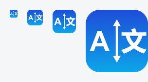
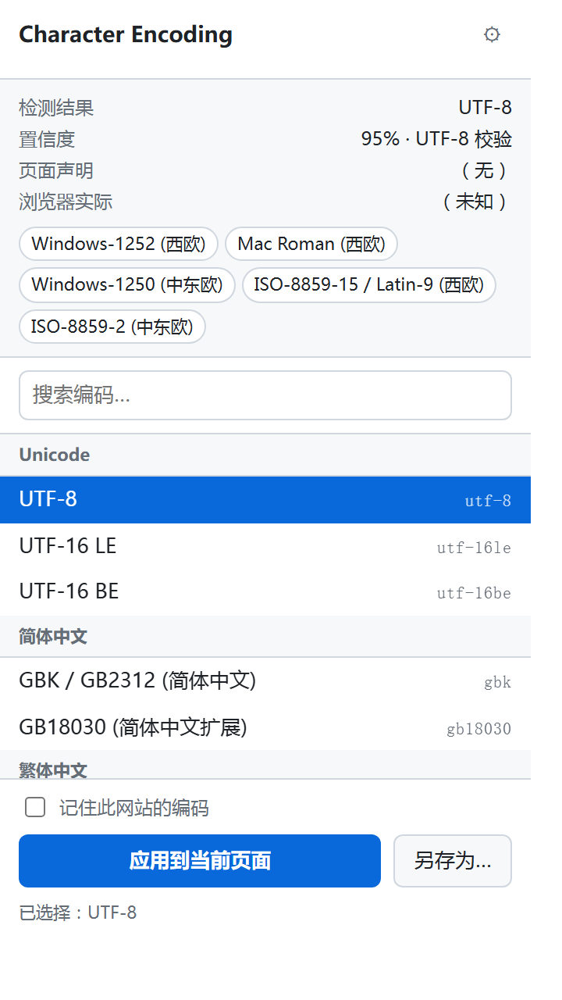
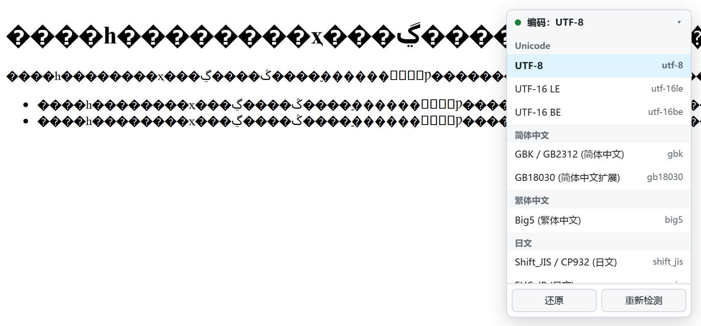
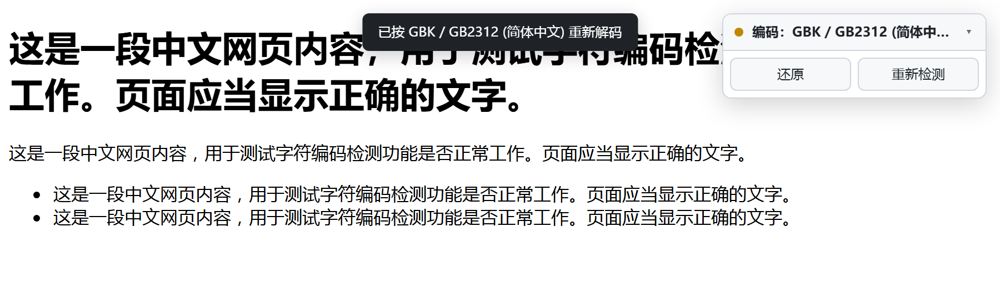

# Character Encoding 编码转换

一个 Chrome 扩展（Manifest V3），用于**检测网页实际使用的字符编码，并把页面按指定编码重新解码显示**，
同时支持把整页**转码成另一种编码并另存为文件**。

覆盖 UTF、GBK/GB18030、Big5、Shift_JIS、EUC-JP、EUC-KR，以及 Cyrillic、希腊文、阿拉伯文、
希伯来文、泰文、中东欧、土耳其、越南和西欧等单字节编码，共 **38 种**。

---

## 图标



图标用「拉丁字母 A」与「汉字 文」夹在一条竖直双向箭头（⇅）之间，表达**字符编码转换**：
箭头是转码动作，左右两种文字代表不同的字符集。

设计取舍：

* **缩小到 16px 仍然成立**。Chrome 工具栏只有 16px，早期把 “CE” 加勾号的方案在
  16px 下糊成一团；这里只有三个元素，A 与 文 都是高对比度实心块面，缩小后仍能分辨。
  箭头在 16px 下退化成一根分隔线，不破坏整体。
* **不依赖英文缩写**。扩展要面对的正是中日韩页面，用真实字符比 “CE” 更直观。
* **配色与弹窗一致**，主色取蓝，与界面主按钮同色系。

图标由 `tools/gen_icons.py` 生成，`tools/check_icons.py` 会校验尺寸、RGBA 模式与圆角透明。

---

## 功能

| 功能 | 说明 |
| --- | --- |
| 编码检测 | 综合 BOM、HTTP 响应头、`<meta charset>` 和统计检测判断页面真实编码 |
| 重新解码 | 选择任意编码后，就地把页面文字替换成正确内容，**不刷新页面**，保留脚本、样式与页面状态 |
| 转码另存 | 把整页从源编码转码成目标编码，保存为 HTML 文件；无法表示的字符会被统计并提示 |
| 页面内工具栏 | 右上角浮动条，显示当前编码，可展开选择编码、一键还原、重新检测 |
| 站点规则 | 为指定网站固定编码，之后访问自动按该编码解码（选项页管理） |

---

## 安装

1. 打开 `chrome://extensions/`
2. 打开右上角「开发者模式」
3. 点击「加载已解压的扩展程序」，选择本目录

---

## 使用

* 点击扩展图标 → 弹窗显示检测结果与编码列表 → 选中编码 → 「应用到当前页面」
* 页面右上角也有浮动工具条，点击标题展开编码列表
* 「另存为…」可把页面转码成指定编码后下载

| 弹窗 | 页面内工具条 | 转码后 |
| --- | --- | --- |
|  |  |  |

---

## 实现要点

### 1. 取回原始字节

浏览器已经按自己猜的编码把页面解码过一次，DOM 里只剩下乱码，**原始字节才是正确内容的唯一来源**。
扩展会重新请求一次页面拿到原始字节：

* 优先由**内容脚本自己发起同源请求**——这样带上的是页面自己的 Cookie，登录后才能看到的页面也能正确处理；
* 若请求被页面 CSP 拦下，再退回**后台脚本**代取（后台脚本不受页面 CSP 约束）。

### 2. 解码

直接使用浏览器内置的 `TextDecoder`，因此与浏览器自身的解码结果完全一致，
支持全部 WHATWG 编码标签。少数浏览器尚未实现的编码（如 ISO-8859-16）由扩展自带码表兜底。

### 3. 编码（导出方向）

浏览器的 `TextEncoder` **只会输出 UTF-8**，即使传入 `gbk` 也会忽略标签
（这一点已在真实 Chrome 中验证）。因此扩展需要自建反向码表。

做法是**在运行时用同一个 `TextDecoder` 反向扫描字节空间**，构建「码点 → 字节」映射：

| 编码 | 需要扫描的序列数 | 耗时 |
| --- | --- | --- |
| GBK | 23 940 | ~24 ms |
| Big5 | ~16 900 | ~10 ms |
| Shift_JIS / EUC-JP / EUC-KR | ~10 000 各 | ~3 ms 各 |
| GB18030 四字节区 | 1 587 600 | 改为离线生成 |

好处是**码表与解码器天然自洽**，不会存在两份数据对不上的问题，也不必打包几十万条目的静态码表。
GB18030 的四字节区太大，改为由 `tools/gen_gb18030_4byte.js` **在真实 Chrome 中生成**
（Chrome 实现的 WHATWG gb18030 与其它实现存在差异，以浏览器为准最保险），
压缩成 210 段线性区间，仅 10 KB。

### 4. 就地替换，而不是刷新页面

重新解码后拿到的是一份新的 HTML。扩展不刷新页面，而是把新文档与当前文档**按文本节点顺序对齐**，
只替换文本节点与属性值：

* HTML 的标签分隔符都是 ASCII 字节，而所有 ASCII 兼容编码都不会把 ASCII 字节吃进多字节序列，
  因此无论按哪种编码解析，**元素结构与文本节点的切分位置都一致**，只有内容不同；
* 脚本、事件绑定、样式、表单状态、滚动位置全部原样保留；
* 若页面被脚本改动过导致结构对不上，或遇到 UTF-16 这类非 ASCII 兼容编码，则退回整页替换。

「还原」按钮会把文本恢复成浏览器最初的解码结果。

### 5. 编码检测

优先级与浏览器一致：**BOM → HTTP 响应头 → `<meta charset>` → 统计检测**。

统计检测是难点：单字节编码会把任意高位字节映射成某种文字，所以「解码后落在某个文字区间」
几乎无法区分候选。真正的判据是「解码结果像不像某种语言」，扩展为此做了两件事：

* **文字纯度门槛**——解码结果里该文字区间的字符占比过低时直接淘汰；
* **语言模型**——
  * 有分词的语言（西里尔、希腊、阿拉伯、希伯来、土耳其、中东欧、越南、西欧）用**常用词命中率**：
    误判成别的编码时词边界与词形都会被破坏，命中率迅速归零；
  * 不分词的语言（中日韩、泰语）用**高频字命中率相对随机基准的显著度（Z 分数）**：
    不同文字的「常用字密度」差别很大（中文常用字只占两万字中的百来个，泰文常用字占了整个泰文区的一半），
    直接比较绝对命中率会让泰文永远赢，换算成相对基准线的 Z 分数后才可以横向比较；
  * 中文额外做**简繁倾向**判断，区分 GBK 与 Big5。

### 6. GB18030 四字节区

Chrome 实现了 WHATWG 版 gb18030，其四字节区与 Python 等实现的映射在 108 万个映射点上有
**24 万余处差异**，因此码表由 Chrome 自身生成。实测该表覆盖 1 087 995 个码点
（含 U+10000 以上的扩展区），逐条用 Chrome 的解码器验证通过。

---

## 目录结构

```
manifest.json
icons/                       扩展图标（由 tools/gen_icons.py 生成）
src/
  lib/
    charsets.js              编码注册表：别名、语系分组、结构类型
    text-codec.js            解码与编码（运行时反向码表）
    detect.js                编码检测
    legacy-tables.js         浏览器未实现的单字节编码码表（ISO-8859-16）
    gb18030-4byte.js         GB18030 四字节区（由真实 Chrome 生成）
  background/service-worker.js  取原始字节、检测、转码、站点规则
  content/content-script.js    页面内工具栏与就地替换
  popup/                     弹窗界面
  options/                   选项页
tools/                       代码生成与测试脚本
```

---

## 测试

```bash
node tools/run_all_tests.js   # 一次跑完全部测试
```

也可以单独运行：

```bash
node tools/test_libs.js            # 单元测试：编解码、检测、往返一致性（88 项）
node tools/test_legacy_fallback.js # 浏览器未实现的单字节编码回退测试（4 项）
node tools/e2e_test.js             # 端到端：真实 Chrome 加载扩展跑完整流程（38 项）
node tools/check_manifest.js       # 校验 manifest 引用的文件是否齐全
node tools/screenshot.js           # 生成界面截图到 screenshots/
```

端到端测试通过 CDP 的 `Extensions.loadUnpacked` 加载扩展（正式版 Chrome 已禁用 `--load-extension`），
本地起一个按不同编码提供同一份页面的服务器，验证：

* 六种编码的页面都能被正确检测；
* 响应头声明与实际编码不符时，乱码能被纠正回正确文字；
* 严格 CSP 的页面也能纠正（走后台脚本兜底路径）；
* 内容脚本的就地替换、「还原」、工具栏注入、站点规则读写；
* 转码导出的字节确实是目标编码，且会报告无法表示的字符。

---

## 已知限制

* 重新解码需要**重新请求一次页面**。对于 POST 提交得到的页面、或由脚本动态生成的内容，
  重新请求拿到的可能不是同一份内容，这类页面不适合用本扩展纠正。
* 重新解码只替换文本与属性值，**不会重新执行页面脚本**；若页面文字依赖脚本运行结果，
  请改用整页替换。
* 扩展请求页面时，后台脚本的请求属于第三方上下文，`SameSite=Lax` 的 Cookie 可能不会带上；
  内容脚本的同源请求没有这个问题，这也是优先走内容脚本的原因。
* `chrome://` 页面、Chrome 应用商店等不允许注入内容脚本的页面无法使用。
* GBK 与 GB18030 对 BMP 内的文字编码完全相同，KOI8-R 与 KOI8-U 也仅在 8 个字节值上有区别，
  这几组之间的区分在原理上就做不到，检测结果会给出其中一个。

---

## 生成代码

部分文件由脚本生成，修改后请重新生成：

```bash
python tools/gen_icons.py          # icons/*.png
python tools/gen_legacy_tables.py  # src/lib/legacy-tables.js
node tools/gen_gb18030_4byte.js   # src/lib/gb18030-4byte.js（需要真实 Chrome）
```
